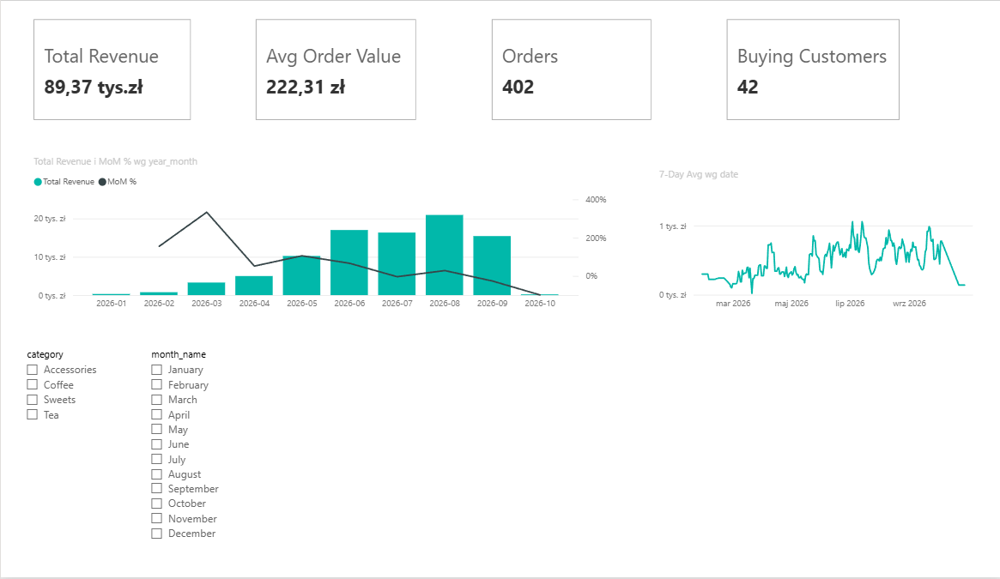
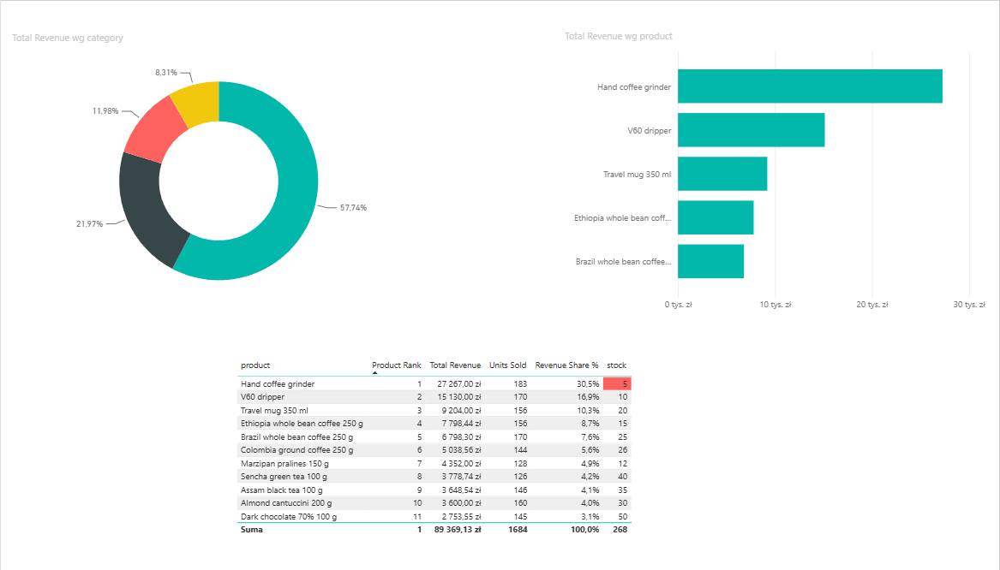
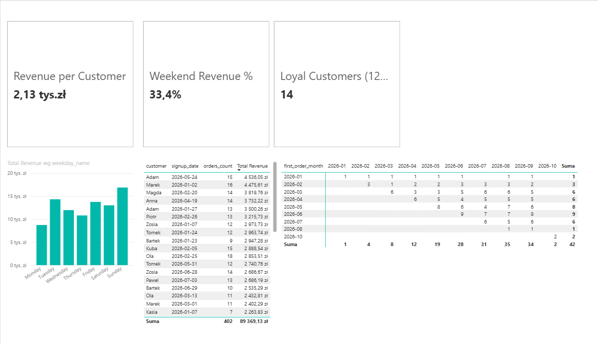
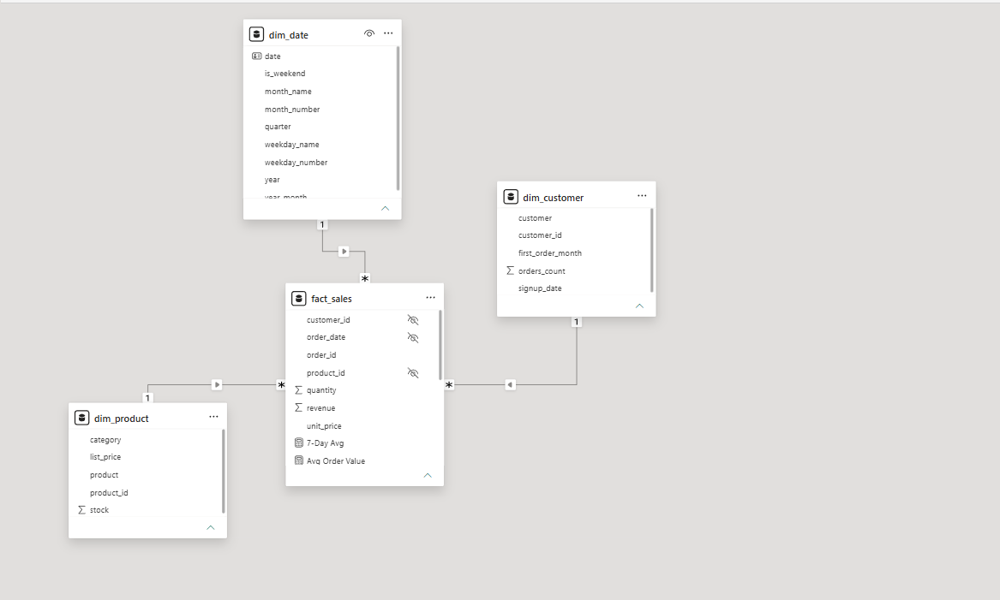

# Sales Dashboard (Power BI)


A Power BI sales report for my online coffee shop [flask-sql-shop](https://github.com/weronikategos/flask-sql-shop). The sales data is exported from the shop's SQLite database with SQL and Python into a **star schema**, and the report is built on top of it with **DAX** measures.



## What's in the report
| Page | What it shows |
|---|---|
| **Overview** | revenue, orders, average order value and buying customers; monthly revenue with month-over-month change; 7-day moving average; category and month slicers |
| **Products** | revenue share by category, product ranking with stock levels (low stock highlighted), top 5 products |
| **Customers** | revenue per customer, loyal customers, weekend share; revenue by weekday; top customers; a cohort matrix by first order month |




## Insights
- **Accessories bring 57.7% of revenue**, and one product, the **hand coffee grinder, makes 30.5% on its own**. It is also the product with the lowest stock (5 left), so it is the first candidate for restocking.
- **Revenue grew month after month** from 298 zł in January to a peak of **20,930 zł in August 2026**. October only contains two test orders, which is why MoM % drops there.
- **Sunday is the best day** (16,862 zł) and **Monday the weakest** (8,716 zł). The weekend brings 33.4% of revenue, more than its 2/7 share of the week.
- **Customers come back**: 14 of 42 buying customers placed 12 or more orders, and the cohort matrix shows that customers keep ordering in the months after their first purchase.

## Data model


| Table | Rows | Contents |
|---|---|---|
| `fact_sales` | 846 | one row per order item: order, date, customer, product, quantity, unit price, revenue |
| `dim_product` | 11 | product, category, list price, stock |
| `dim_customer` | 61 | customer, sign-up date, first order month (cohort), number of orders |
| `dim_date` | 365 | a gap-free calendar for 2026 with month and weekday names, marked as the date table |

Relationships go from `fact_sales` to each dimension (many-to-one, single direction).

## DAX measures
All 14 measures are in [`measures.dax`](measures.dax):
- basics: `Total Revenue`, `Orders`, `Units Sold`, `Avg Order Value`, `Buying Customers`, `Revenue per Customer`
- time intelligence: `Revenue Prev Month`, `MoM %`, `Revenue YTD`, `7-Day Avg`
- products: `Revenue Share %`, `Product Rank`
- customers: `Loyal Customers (12+ orders)`, `Weekend Revenue %`

## Files
| Path | What it is |
|---|---|
| `sales-dashboard.pbix` | the report, opens in Power BI Desktop |
| `sales-dashboard.pbip` + `sales-dashboard.Report/`, `sales-dashboard.SemanticModel/` | the same report as a Power BI Project (text files: TMDL model and PBIR report), so changes are readable in git |
| `export_data.py` | exports the shop database to the CSV files in `data/` |
| `tests/` | pytest tests for the exporter |
| [`docs/report-guide.md`](docs/report-guide.md) | how the report was built, step by step |

## Refreshing the data
```bash
pip install -r requirements.txt
# copy the database out of the shop's Docker container (in the flask-sql-shop folder)
docker compose cp shop:/app/instance/shop.db ../sales-dashboard-powerbi/shop.db
python export_data.py --db shop.db --out data
python -m pytest
```
Then open the report and click **Home → Refresh**. The CSV folder is set in the `DataFolder` parameter (**Transform data → Edit parameters**); change it if the repository is in a different place on your computer.

## Tech stack
SQL (SQLite), Python, pandas, Power BI Desktop, Power Query, DAX, pytest, GitHub Actions
